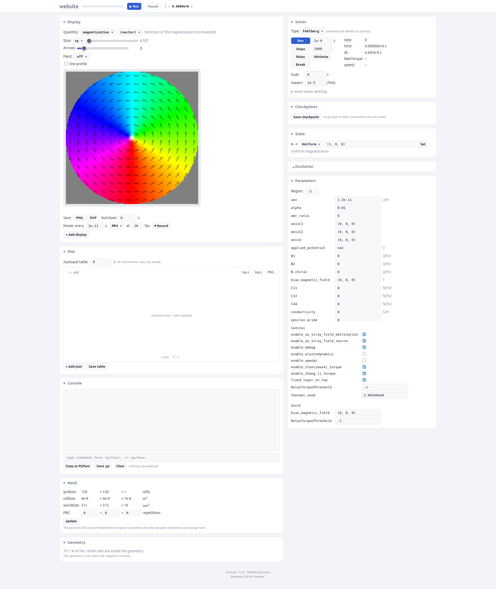

:nosearch:

Browser GUI
===========

mumax⁺ comes with a browser GUI. With it you can follow a simulation while it
runs and change it interactively: look at any quantity, plot table columns,
change parameters and solver settings, paint the magnetization, add excitations
and type Python in a console. Everything that
changes the simulation is recorded, so you can copy it back into your script as
Python afterwards.

Starting the GUI
----------------

Set up a world and magnet as usual. Instead of running the simulation in the
script, create a :class:`~mumaxplus.gui.GUI` and call its
:meth:`~mumaxplus.gui.GUI.run` method.

.. code-block:: python

    from mumaxplus import Ferromagnet, Grid, World
    from mumaxplus.gui import GUI
    from mumaxplus.util import Circle, vortex

    world = World(cellsize=(4e-9, 4e-9, 10e-9))
    disk = Circle(512e-9)
    disk.translate(254e-9, 254e-9, 0)
    magnet = Ferromagnet(world, Grid((128, 128, 1)), geometry=disk)

    magnet.msat = 800e3
    magnet.aex = 13e-12
    magnet.alpha = 0.01
    magnet.magnetization = vortex(magnet.center, 8e-9, 1, 1)

    gui = GUI(world, namespace=globals(), open_browser=True)
    gui.run()

When the script reaches ``gui.run()``, it prints a line like

.. code-block:: console

    //entering interactive mode: open http://127.0.0.1:35367/?token=...

and, with ``open_browser=True``, opens this page in your browser. The
``token`` in the URL protects the page: only someone with the full URL can
control the simulation. ``gui.run()`` keeps the script alive until you press
Ctrl-C.

Passing ``namespace=globals()`` makes the variables of your script (here
``world`` and ``magnet``) available in the console of the page.

.. tip::

   By default the server only accepts connections from the computer it runs
   on. To use the GUI of a simulation on a remote machine (e.g. a GPU server),
   forward the port over SSH,

   .. code-block:: bash

      ssh -L 35367:localhost:35367 user@gpu-server

   and open the printed URL in the browser on your own computer. If port 35367
   is taken, the GUI uses the next free one; forward that port instead.

The page that opens will look like this:

What is in the page
-------------------

The page consists of panels that you can show or hide by clicking their title.

- **Display**: an image of a quantity of the selected magnet, e.g. the
  magnetization or the effective field, or one of its components. A single
  component has a colorbar, and you can pick its colormap. You can pick
  the slice through the magnet (``xy``, ``xz`` or ``yz``), draw a line profile,
  save the image as PNG or the quantity as OVF, and record a movie. With
  *+ Add display* you can show several quantities at once.
- **Paint**: on each display. With the brush you set any parameter in
  the cells you drag over; with *place m* and *place u* you click to put an object such
  as a skyrmion or Gaussian spherical at that position.
- **Plot**: plots of the table columns against another column. Pick the columns to show
  in the plot. Quantities that are not saved in the table are sampled for the plot only.
- **Console**: type Python, e.g. ``magnet.alpha = 0.1``, or commands such
  as ``Run(1e-9)``. See the :doc:`API <../gui>` for the full list.
  *Copy as Python* gives everything you changed in the page as lines to add to
  your script.
- **Mesh** and **Geometry**: the grid and cell size, and the number of periodic
  repetitions, which can be changed here.
- **Solver**: *Run* for a given time, take a number of *Steps*, *Relax* or
  *Minimize*, and *Break* a run. You can also switch the Runge-Kutta method and
  change ``fixdt``, ``maxerr`` and other solver settings.
- **Checkpoints**: keep a copy of the state (magnetization, elastic fields,
  time) in memory and go back to it later.
- **State**: set the magnetization to a configuration of
  :mod:`mumaxplus.util.config`, e.g. a vortex or a skyrmion. With
  ``enable_elastodynamics`` on, the elastic displacement u can be set there too,
  e.g. to a Gaussian bump.
- **Excitation**: add an expression of time to a parameter in the whole magnet, a region
  or a mask.
- **Parameters**: all material parameters of the selected magnet. Set a value
  everywhere (region ``-1``) or in one region.

If the world has several magnets, choose which one the panels show with the
*magnet* selector at the top of the page.

Setting up the page from the script
-----------------------------------

Instead of setting everything up by hand in the page every time, you can add
table columns, plots and displays from the script, before calling
``gui.run()``.

.. code-block:: python

    gui = GUI(world, namespace=globals(), open_browser=True)

    # columns of the table, saved in table.txt
    gui.table_add(magnet.magnetization, name="m")  # adds mx, my, mz
    gui.table_add(magnet.total_energy, name="E")
    gui.table_add(lambda: magnet.magnetization.average()[2] ** 2, name="mz2")
    gui.table_autosave(1e-12)  # save a row every ps of simulation time

    gui.add_plot("t", "mx,my")  # the first call replaces the default plot
    gui.add_plot("t", "E")
    gui.add_display("magnetization")  # the first call replaces the default display
    gui.add_display("effective_field", comp="z")

    gui.run()

With ``gui.table_autosave(0)`` (the default) nothing is written to
``table.txt``; the plots then show a live preview only. *Save table* in the
page downloads the rows shown in the plots. Each run of the script starts a new
``table.txt``: the first row it saves overwrites the file of an earlier run.

Using the GUI in Jupyter
------------------------

In a notebook, ``gui.run()`` would block the cell. Use
``gui.run(block=False)`` instead: the simulation is then driven by a
background thread, and you can keep using other cells. Methods like
:meth:`~mumaxplus.gui.GUI.add_plot` can still be called. Stop the GUI with
``gui.stop()``.

.. code-block:: python

    gui = GUI(world, namespace=globals())
    gui.run(block=False)
    print(gui.url)

.. note::

   While the GUI runs in the background, it owns the simulation. Change the
   simulation from the GUI console rather than from other notebook cells, so
   the two do not interfere.
